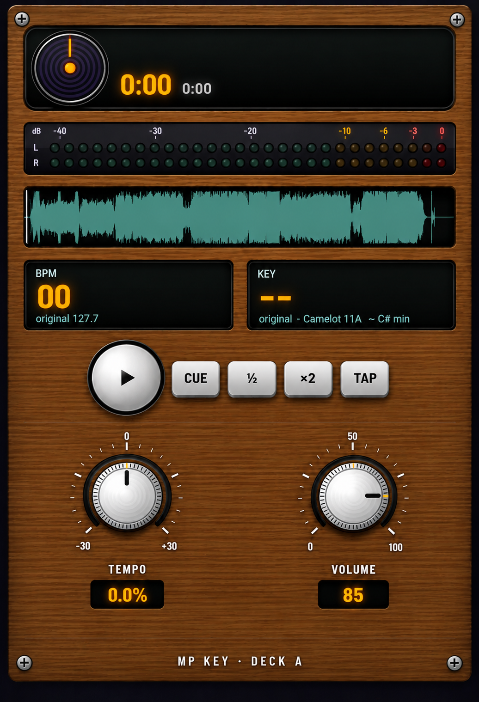

# MP Key – FL Studio VST3 (Windows)

MP Key is a VST3 audio plugin designed for music producers. It provides song key detection, BPM detection, tempo control, and volume control.

## Easy Installation Guide

1. Open the GitHub repository.
2. Download the latest MP Key VST3 ZIP file from the **Releases** section.
3. Extract the downloaded ZIP file.
4. Copy the entire `MP Key.vst3` folder to:

   `C:\Program Files\Common Files\VST3`

5. Open FL Studio.
6. Go to **Options → Manage Plugins**.
7. Click **Find Plugins** to scan for MP Key.

## Build from Source

To build MP Key yourself, you will need:

- Visual Studio 2022 (C++ workload)
- CMake

Run these commands:

```bash
cmake -B build -G "Visual Studio 17 2022" -A x64
cmake --build build --config Release --target MPKey_VST3
```

## How to Use

- Load an audio file into FL Studio.
- Open MP Key from the plugin list.
- Use the available controls to adjust tempo and volume.
- Check the displayed BPM and key information.

## Project Structure

- `Source/ui/index.html` – Plugin user interface.
- `Source/PluginProcessor.*` – Audio processing and plugin functionality.
- `Source/PluginEditor.*` – Plugin editor and WebView2 integration.

## Important Notice

MP Key is currently in **Beta**. It has not yet been fully tested in a Windows FL Studio environment. Some features may not work as expected. Feedback and bug reports are welcome.

# MP Key – FL Studio VST3 (Windows)

MP Key এখানে একটা ইফেক্ট প্লাগিন। FL Studio-র মিক্সারের যেকোনো স্লটে বসালে এর দুই ডেকের গান মিক্সারের ওই ট্র্যাকে বাজে।
ইন্টারফেস, BPM/কী ডিটেকশন, VU মিটার আর টেম্পো/পিচ নব আগের অ্যাপের মতোই।

## .vst3 বানানোর সহজ উপায় (কম্পিউটারে কিছু ইনস্টল লাগে না)
1. github.com-এ একটা প্রাইভেট রিপোজিটরি খুলুন।
2. এই ফোল্ডারের সব ফাইল (লুকানো `.github` ফোল্ডারসহ) রিপোজিটরিতে আপলোড করুন।
3. Actions ট্যাব → "Build MP Key (Windows VST3)" → Run workflow।
4. ১০–১৫ মিনিট পর রান শেষ হলে নিচের Artifacts থেকে `MP-Key-Windows` নামান।
   ভেতরে আছে `MP Key.vst3` ফোল্ডার আর `MP Key.exe` (FL ছাড়া আলাদা টেস্ট করার জন্য)।

## নিজের পিসিতে বানাতে চাইলে
Visual Studio 2022 (C++ workload) ও CMake লাগবে।
```
cmake -B build -G "Visual Studio 17 2022" -A x64
cmake --build build --config Release --target MPKey_VST3
```
ফাইল পাবেন: `build/MPKey_artefacts/Release/VST3/MP Key.vst3`

## FL Studio-তে ইনস্টল
1. `MP Key.vst3` ফোল্ডারটি `C:\Program Files\Common Files\VST3` এ কপি করুন।
2. FL Studio → Options → Manage plugins → "Find installed plugins" (verify চালু রেখে স্ক্যান)।
3. মিক্সারের একটা ইনসার্ট স্লটে MP Key যোগ করুন।

## ব্যবহার
- গান আনা: ফাইল এক্সপ্লোরার বা FL-এর ব্রাউজার প্যানেল থেকে অডিও ফাইল ডেকের ওপর ড্র্যাগ করুন। অথবা প্লেলিস্ট স্ক্রিনে "Add song" চাপুন।
- FL-এ ফেরত নেওয়া: ডেকের ডানে "DRAG to FL" বাটন চেপে ধরে FL-এর প্লেলিস্ট বা চ্যানেলে টেনে ফেলুন। মূল ফাইলের কপি যায়।
- FL-এর প্লেলিস্টের ক্লিপ সরাসরি ড্র্যাগ করে আনা যায় না (FL প্লাগিনকে এই সুবিধা দেয় না)। আগে ক্লিপটা WAV এক্সপোর্ট করে নিন।
- প্লাগিনের উইন্ডো বন্ধ করলে বাজানো থেমে যায়। বাজানোর সময় উইন্ডো খোলা রাখুন।
- FL-এর "Smart disable" চালু থাকলে ইনপুটে শব্দ না থাকা ইনসার্ট FL বন্ধ করে দিতে পারে। প্লাগিনের স্লটে Smart disable বন্ধ করুন।
- গান বাজে প্লাগিনের নিজস্ব প্লে বাটনে, FL-এর ট্রান্সপোর্টের সাথে চলে না।
- সাইন-আপ ও গানের লাইব্রেরি `%AppData%\MPKey\WebView` এ সেভ হয়।

## ফাইলের কাঠামো
- `Source/ui/index.html` – পুরো ইন্টারফেস। প্লাগিনের ভেতরে ঢুকিয়ে দেওয়া হয়।
- `Source/PluginProcessor.*` – অডিও ইঞ্জিন (দুই ডেক, টেম্পো/পিচ একসাথে, ভলিউম, লেভেল মাপা)।
- `Source/PluginEditor.*` – WebView2 উইন্ডো এবং ইন্টারফেসের সাথে যোগাযোগ।

## দ্রষ্টব্য
কোডটা আমার এখানে কম্পাইল করে চালানো যায়নি। ইন্টারফেসের জাভাস্ক্রিপ্ট অংশ নকল সার্ভার দিয়ে পরীক্ষা করা হয়েছে। প্রথম বিল্ডে কোনো কম্পাইল এরর এলে এররের লেখাটা পাঠান।
WebView2 রানটাইম Windows 10/11-এ সাধারণত আগে থেকেই থাকে।
